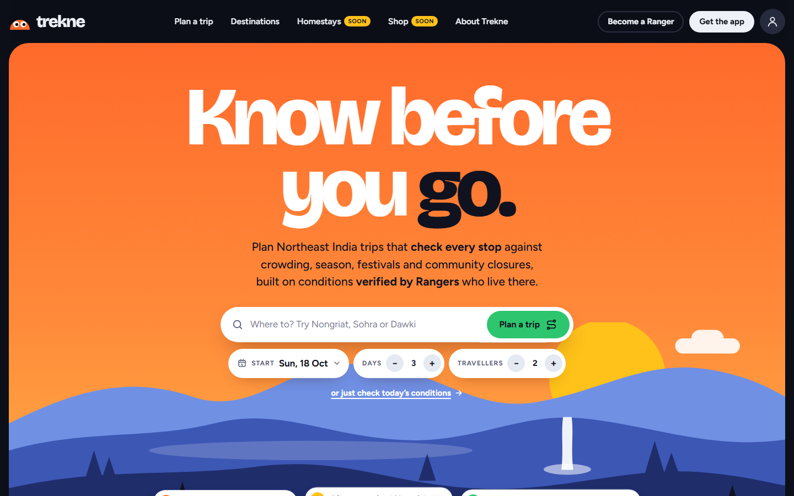
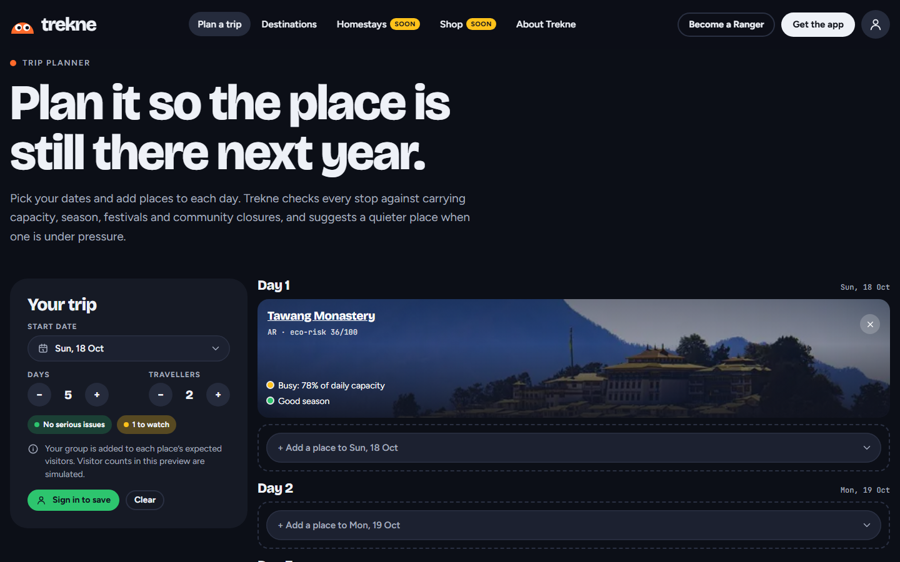
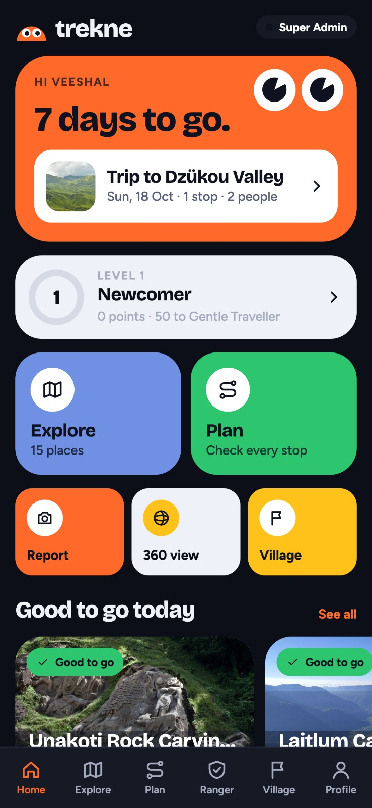
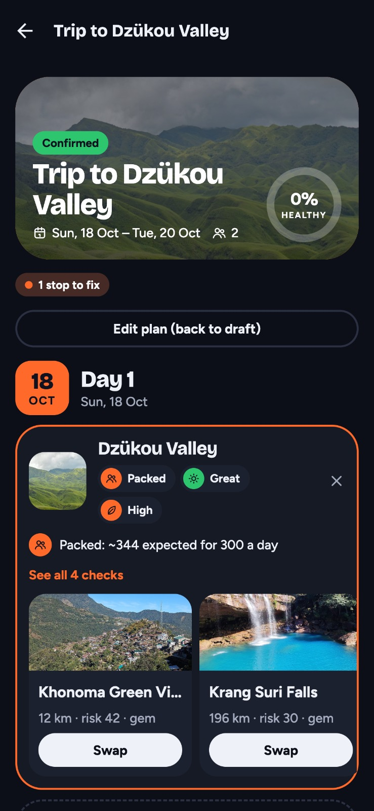
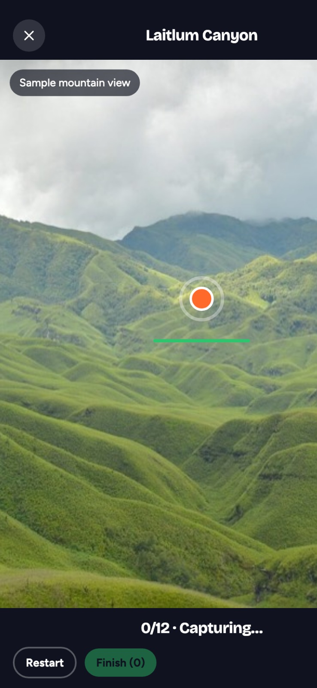
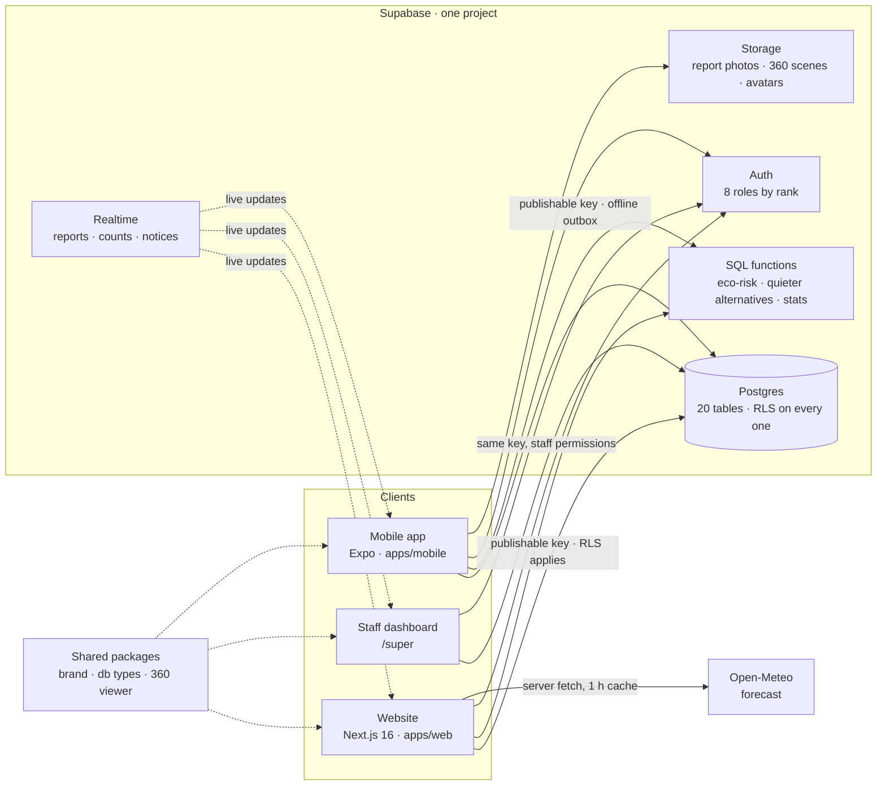

<div align="center">


<h1>Trekne</h1>

<p><strong>Know Before You Go.</strong> Sustainable tourism, eco-risk and cultural heritage intelligence for Northeast India.<br>
A trip planner that checks every stop against crowding, eco-risk, season and local rules, using field reports from local Rangers.
One database, three apps: the website, the staff dashboard and the mobile app.</p>

<p>
  
  
  
  
  
  
  
  
  
</p>

<p>
  <a href="https://trekne-web.vercel.app/"><b>Live site</b></a> ·
  <a href="https://trekne-web.vercel.app/planner">Plan a trip</a> ·
  <a href="https://trekne-web.vercel.app/destinations">Destinations</a> ·
  <a href="#routes"><b>All page links</b></a>
</p>

<p>
  <a href="https://expo.dev/artifacts/eas/Z6SRyOhrXRHo0I7Q03uRTw8czjE7p-PMjTOKGz_oFf8.apk"><b>Get the Android app (APK)</b></a> ·
  <a href="https://drive.google.com/drive/folders/1OiwdPSL33F1t0ycGa5IgK0oeecPH2pZC"><b>Video demo</b></a> ·
  <a href="https://trekne-web.vercel.app/login">Sign in</a> ·
  <a href="https://trekne-web.vercel.app/super"><b>Staff dashboard</b></a>
</p>

</div>

> [!NOTE]
> **Built by Team Commit&Run** (Jeu Machahary, Veeshal D Bodosa, Aakash Agrahari) for the PS_CIVICTECH problem statement:
> Sustainable Tourism, Eco-Risk & Cultural Heritage Intelligence. Everything in the live build is **sample data**,
> and the site says so wherever a number could be mistaken for a live reading.

<p align="center">
  
  
</p>
<p align="center">
  
  
  
</p>

---

## Contents

| Section |
| --- |
| [Overview](#overview) · [Stack](#stack) · [Architecture](#architecture) |
| [Getting started](#getting-started) · [Environment](#environment) · [Scripts](#scripts) |
| [Project structure](#project-structure) · [Routes](#routes) |
| [Data model](#data-model) · [Roles and permissions](#roles-and-permissions) · [Demo accounts](#demo-accounts) |
| [Data honesty](#data-honesty) · [Brand](#brand) · [Deploy](#deploy) · [Roadmap](#roadmap) |

## Overview

| Area | What it does |
| --- | --- |
| **Trip planner** | Pick a start date, days and travellers, add places to each day. Every stop is checked for that day: carrying capacity (your group counts toward it), season, festivals, community closures and eco-risk. A packed or poor-season stop is flagged and quieter alternatives nearby are offered as one-tap swaps |
| **Destination explorer** | Every published place across the 8 states: search and filters (state, month, good season, lesser-known), a card grid and a MapLibre map sharing one selection |
| **Place pages** | Photo mosaic and viewer with credits, community notices, at-a-glance tiles (eco-risk, crowding, this month's season, access), heritage rules, Ranger reports, 360° scenes and a "Plan your visit" column |
| **Account** | Saved trips start as drafts; confirming one adds the group to each place's expected visitors. Each trip card shows the first stop's photo and a day-by-day weather card (Open-Meteo) |
| **Rangers** | Locals who file field reports with photo evidence and capture 360° scenes from the app. Reports are verified by staff before they shape any advisory |
| **Communities** | Community stewards propose heritage protocols, closures and events for their own places |
| **Staff dashboard** (`/super`) | Moderate reports and 360° scenes, manage places, seasons, events, heritage and notices, see visitor pressure on a map and the trips feed, manage users and roles, read the audit log |
| **Mobile app** | Explore, plan, Ranger mode (reports and guided 360° capture with an offline outbox), community tab, profile and progress |
| **Coming soon** | Homestays and Shop are preview pages that collect a business waitlist |

## Stack

| Layer | Choice | Notes |
| --- | --- | --- |
| Website + dashboard | **Next.js 16** (App Router) | `apps/web`; plain global CSS with variables, no UI kit |
| Mobile | **Expo SDK 57** + React Native 0.86 | `apps/mobile`; Expo Router, EAS builds |
| Language | **TypeScript** | Shared generated database types in `packages/db` |
| Data | **Supabase** | Postgres, Auth, Row Level Security, Storage, Realtime |
| Maps | **MapLibre GL** | Explorer and dashboard maps |
| 360° | **three.js** | `packages/viewer`, used by the site, the dashboard and the app |
| Weather | **Open-Meteo** | Daily and hourly forecast on trip cards, cached for an hour |
| Hosting | **Vercel** | Root directory `apps/web` |
| Package manager | **pnpm 10** workspaces | Do not use npm here |

## Architecture



Three things follow from that shape:

- **Security lives in the database, not the app.** 54 row-level security policies on 20 tables decide what each role can
  read and write. The apps only hold the publishable key, so a bug in the UI cannot leak another user's data.
- **The logic that matters is SQL.** The eco-risk score, today's overview for every place (`destination_overview`) and
  quieter alternatives (`suggest_alternatives`) are database functions, so the website, the dashboard and the app give the same answer.
- **States, ecosystems, place types and roles are data.** Adding a state is done in the dashboard, not in code.

## Getting started

```bash
pnpm install                                   # once, at the repo root (pnpm 10, see packageManager)
pnpm web                                       # http://localhost:3000, dashboard at http://localhost:3000/super
pnpm mobile                                    # Expo dev server; scan the QR code with Expo Go
```

The 360° capture needs a real phone (camera and gyroscope); simulators can't run it.

Adding dependencies:

```bash
pnpm add <pkg> --filter @trekne/web            # a web dependency
cd apps/mobile && pnpm exec expo install <pkg> # a mobile dependency (SDK-matched)
```

### Environment

Both files are git-ignored. Use the **anon / publishable** key from Supabase → Project Settings → API.

| Variable | File | What it is |
| --- | --- | --- |
| `NEXT_PUBLIC_SUPABASE_URL` | `apps/web/.env.local` | Supabase project URL |
| `NEXT_PUBLIC_SUPABASE_ANON_KEY` | `apps/web/.env.local` | Publishable key; RLS applies to everything it does |
| `EXPO_PUBLIC_SUPABASE_URL` | `apps/mobile/.env.local` | Supabase project URL |
| `EXPO_PUBLIC_SUPABASE_ANON_KEY` | `apps/mobile/.env.local` | Publishable key |
| `EXPO_PUBLIC_SITE_URL` | `apps/mobile/.env.local` | Website origin, for links and share pages from the app |

```bash
# apps/web/.env.local
NEXT_PUBLIC_SUPABASE_URL=https://yhrloltsznexpxuwyjhr.supabase.co
NEXT_PUBLIC_SUPABASE_ANON_KEY=...
```

### Scripts

| Script | What it does |
| --- | --- |
| `pnpm web` | Website and dashboard dev server |
| `pnpm mobile` | Expo dev server |
| `pnpm build:web` | Production build of the website |
| `pnpm db:types` | Regenerate `packages/db/src/database.types.ts` from the linked Supabase project |

## Project structure

```text
apps/
  web/                 Next.js 16: the website and the staff dashboard (/super)
    app/(site)/        public pages
    app/(auth)/login   public sign-in
    app/super/(crm)/   staff dashboard sections
    components/        UI, one folder per feature (plan/, explore/, place/, intel/, account/, crm/)
    lib/               data access, trip maths, photos, weather
    public/            place photos, Northeast doodle sprite
  mobile/              Expo SDK 57 app (src/app is the Expo Router tree)
packages/
  brand/               colours, fonts, icons, status labels, game levels: shared by web and app
  db/                  generated Supabase types, panorama maths
  viewer/              three.js 360° viewer
supabase/migrations/   schema, sample data, functions, policies
docs/                  PLAN.md (problem statement mapping) and screenshots
DESIGN.md              design system: read before any UI work
```

## Routes

**Website** · [trekne-web.vercel.app](https://trekne-web.vercel.app/)

| Route | What |
| --- | --- |
| [`/`](https://trekne-web.vercel.app/) | Hero with planning search (place, start date, days, travellers), places to go, live bento, how it works, Destination Intelligence |
| [`/planner`](https://trekne-web.vercel.app/planner) | Trip planner (`?add=<slug>&start=&days=&party=`, `?trip=<id>` to edit a saved trip) |
| [`/destinations`](https://trekne-web.vercel.app/destinations) | Explorer: filters, card grid and map sharing one selection (`?place=<slug>`) |
| [`/places/dzukou`](https://trekne-web.vercel.app/places/dzukou) | A place page (`/places/[slug]`) |
| [`/about`](https://trekne-web.vercel.app/about) | About Trekne and the eight states (`/how-it-works` redirects here) |
| [`/account`](https://trekne-web.vercel.app/account) | Saved trips with photos and weather, field work, profile |
| [`/login`](https://trekne-web.vercel.app/login) | Sign in or create an account (Traveller / Ranger) |
| [`/rangers`](https://trekne-web.vercel.app/rangers) · [`/authorities`](https://trekne-web.vercel.app/authorities) · [`/roadmap`](https://trekne-web.vercel.app/roadmap) | Linked from the footer |
| [`/homestays`](https://trekne-web.vercel.app/homestays) · [`/shop`](https://trekne-web.vercel.app/shop) · [`/business`](https://trekne-web.vercel.app/business) | Coming soon, with the business waitlist |

**Staff dashboard** · [trekne-web.vercel.app/super](https://trekne-web.vercel.app/super)

| Section | What |
| --- | --- |
| Dashboard | Platform stats and recurring issues |
| Reports · Scenes | Moderate Ranger field reports and 360° scenes |
| Destinations · Heritage · Events · Notices | Places, capacities, seasons, heritage protocols, festivals, community closures |
| Map · Planning | Visitor pressure on a map; the planned-trips feed authorities forecast from |
| Users · Roles · Audit · Waitlist | Accounts and role requests, role permissions, the audit log, business waitlist |

**Mobile app** · [download the APK](https://expo.dev/artifacts/eas/Z6SRyOhrXRHo0I7Q03uRTw8czjE7p-PMjTOKGz_oFf8.apk)

| Screen | What |
| --- | --- |
| Home · Explore · Plan | Trip countdown, places good to go today, the map and the planner |
| Ranger · Report · Capture | Field reports with photos, guided 360° capture (12-shot ring or 29-shot sphere), offline outbox |
| Community · Profile | Community notices and heritage; points and levels |
| `destination/[slug]` · `trip/[id]` · `scene/[id]` | Place, trip and 360° scene detail |

## Data model

Twenty tables, all with Row Level Security, in `supabase/migrations/`.

| Group | Tables |
| --- | --- |
| Places | `states`, `destinations`, `seasonal_conditions`, `indicators`, `recommendations`, `heritage_sites`, `events`, `community_notices` |
| Field data | `reports`, `report_photos`, `panoramas`, `visitor_counts` |
| Planning | `trips`, `trip_stops` |
| People | `profiles`, `roles`, `permissions`, `staff_invites`, `waitlist` |
| Trust | `audit_log` (trigger-written) |

Key functions: `destination_overview(on_day)` (capacity, expected visitors, season and eco-risk for every place on a day),
`suggest_alternatives` (quieter places nearby), `crm_stats`, `recurring_issues`, `my_progress`, and the role guards
`has_perm`, `my_rank`, `set_user_role`, `invite_staff`.

Storage buckets: `report-photos`, `panoramas`, `avatars`.

```bash
supabase link --project-ref yhrloltsznexpxuwyjhr
supabase migration new <name>      # write SQL in supabase/migrations/
supabase db push                   # apply to the project
pnpm db:types                      # regenerate the shared types
```

## Roles and permissions

Eight roles, ranked. Nobody can grant a role at or above their own rank.

| Role | Rank | Can |
| --- | --- | --- |
| Super admin | 100 | Everything, including roles and other admins |
| Admin | 90 | Run the platform: users, places, heritage, events, moderation, all trips, waitlist |
| Moderator | 60 | Verify Ranger reports and 360° scenes |
| Tourism authority | 50 | Capacity, seasons, events, visitor counts, the trips forecast |
| Community steward | 30 | Propose heritage protocols and events, file field reports |
| Ranger | 20 | File field reports and 360° scenes, log visitor counts |
| Business | 15 | Homestay, operator or guide business (listings are coming soon) |
| Traveller | 10 | Plan trips and read advisories |

Each role lands on its own home after signing in: staff roles in the dashboard, Rangers in their account, travellers in the planner.

## Demo accounts

Public roles sign in at [`/login`](https://trekne-web.vercel.app/login) and in the app:

| Role | Email | Password |
| --- | --- | --- |
| Traveller | `demo-traveller@trekne.in` | `PZG_KEpy1yHJlh-1izMjQjU3kkWwLM9M` |
| Ranger | `demo-ranger@trekne.in` | `nJ3jK0CJz-wqTylK-gdIIQCT5laI2x_3` |
| Community steward | `demo-community@trekne.in` | `PMpmCk5Wb9ELvt28l31QJXISMj-89YEs` |
| Business | `demo-business@trekne.in` | `53crnqfarKyv6M5ARAVFcmMU3XHdCUiO` |

> [!IMPORTANT]
> Staff demo logins (tourism authority, moderator, admin, super admin) for the [staff dashboard](https://trekne-web.vercel.app/super)
> are shared with judges in the pitch deck, not here: they can change roles and data on the live site, and this repository is public.

## Data honesty

Trekne's promise is "we don't guess", and the UI follows it:

- Every condition shows where it came from: **Verified**, **Official**, **Pending review** or **Unverified**. Unconfirmed reports are drawn dashed.
- Unknown numbers render as **"Not verified"**, never as an invented value or a `0`.
- Caution and risk segments only come from verified or official sources; stale reports expire.
- Forecasts beyond Open-Meteo's 16-day window say so instead of showing a guess.
- While data is simulated, the site carries a visible "Pilot preview · simulated data" label.
- AI never has the final word on safety: staff approve every advisory.

## Brand

| Token | Hex | Use |
| --- | --- | --- |
| Orange | `#FF6A2B` | Primary, mascot, hero sky |
| Yellow | `#FFC21A` | Sun, highlights, pending status |
| Blue | `#7090E4` | Hills, official (IMD) status |
| Green | `#2DC56E` | CTA, verified status |
| Ink | `#10131F` | Text, deep sections |

Display type is Bricolage Grotesque, body Figtree, data JetBrains Mono. Tokens are defined once in `packages/brand/src/tokens.ts`
and mirrored as CSS variables in `apps/web/app/globals.css`. Read [DESIGN.md](DESIGN.md) before any UI work.

## Deploy

**Website (Vercel).** Vercel detects pnpm from `pnpm-lock.yaml`. Set **Root Directory = `apps/web`** and add the two
`NEXT_PUBLIC_SUPABASE_*` variables. Run `supabase db push` before deploying when new migrations land.

**Mobile (EAS).** Builds are configured in `apps/mobile/eas.json`; `eas build -p android` produces the APK.

## Roadmap

| When | Milestone |
| --- | --- |
| Oct 2026 | **Built:** website, staff dashboard and mobile app, sample data for all 8 states |
| Jan 2027 | District pilot in Assam and Meghalaya: real capacities and visitor counts, app on the Play Store |
| Apr 2027 | Live IMD / Open-Meteo weather in the eco-risk score; AI advisories that staff approve |
| Oct 2027 | Homestays and guides bookable, 10 districts |
| 2028–29 | All 8 states, 25 districts |

See [docs/PLAN.md](docs/PLAN.md) for how this maps to the problem statement.

<div align="center">
<sub>Made with ♥ by Team Commit&Run · Jeu Machahary · Veeshal D Bodosa · Aakash Agrahari</sub>
</div>
